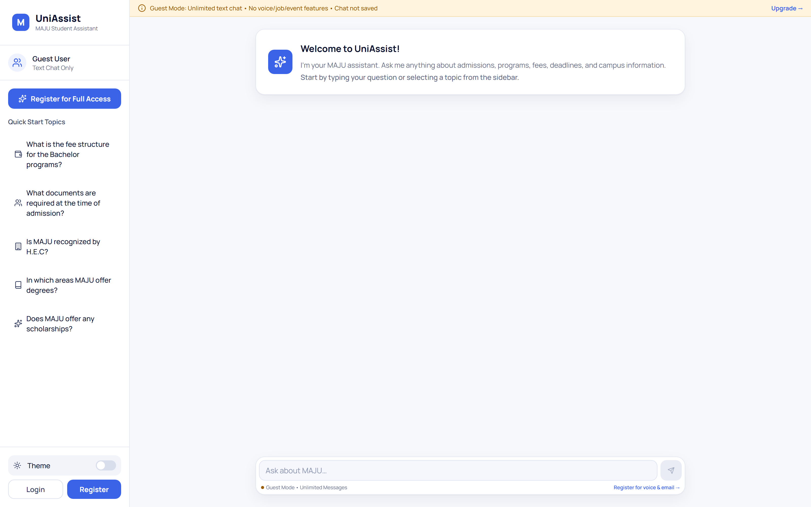

# UniAssist

> A centralized AI student portal for Muhammad Ali Jinnah University (MAJU) — a Retrieval-Augmented Generation chatbot with voice and Roman-Urdu support, an issue tracker, a staff department portal, and an admin panel with a vector-database knowledge-base manager.


UniAssist unifies every routine student interaction with the university behind one AI-first interface. Students (and guests) chat with **MAJU Assistant**, a RAG assistant grounded in the university's own website content and admin-curated documents — in English, Roman Urdu, or a mix, by text or voice. Beyond the chatbot, students raise support tickets to specific departments, staff triage and resolve them, and admins manage users, departments, audit trails, and the underlying vector knowledge base from a dedicated dashboard.

<p align="center">
  
</p>

## ✨ Features

### 🤖 AI Assistant (RAG)
- **Retrieval-Augmented Generation** grounded in scraped MAJU website content plus admin-uploaded documents — answers are drawn from a vector store, never hallucinated free-form.
- **Hybrid retrieval**: semantic vector search (ChromaDB + `all-MiniLM-L6-v2` embeddings) merged with a TF-IDF keyword fallback so exact terms (fees, emails, course codes) are never missed.
- **Conversation memory**: the last few turns are forwarded to the LLM so follow-ups like *"and its fee?"* resolve correctly; elliptical questions also re-prepend the prior topic to the retrieval query.
- **Multilingual output**: English, Roman Urdu, and mixed replies. A language detector picks the target, and a layered guard forces Latin-script Roman Urdu with Urdu (not Hindi) vocabulary.
- **Voice input**: record a question, transcribe it locally with `faster-whisper` (self-hosted Whisper, no cloud STT), then review or send.
- **Pluggable LLM backend**: one `USE_LOCAL_LLM` flag switches between cloud failover across **Groq** and **Google Gemini** (default, with multi-key rollover on rate limits) and a local **Ollama** model (Llama 3.2).
- **Content moderation**: every question is screened; flagged messages are refused and the user is reported to admins via an internal webhook.
- **Guest mode**: unauthenticated visitors can chat via a session-scoped history without an account.

### 🎫 Issue Tracker & Department Portal
- Students create tickets (with file attachments) routed to a department; track status and reply in a threaded conversation.
- **Staff portal** for department members: dashboard stats, assigned/department issue queues, status updates, ticket assignment, and staff replies.
- **Complaints from the chatbot**: under any bot reply a student can tap "Register a complaint" — the department is pre-selected from the message, the chat transcript is attached, and the ticket appears in My Issues. Complaint-like messages get the button highlighted.
- **SLA escalation**: a ticket with no staff response within its department's SLA (default 48 h, configurable per department) is marked Overdue and the department head (or the whole department) and admins are alerted.
- **Feedback**: after a ticket is resolved the student rates it 1–5; admins see per-staff performance (assigned, resolved, average first response time, average rating).
- In-app notifications and email notifications on ticket activity.

### 🛠️ Admin Panel
- Dashboard with charts (recharts) for users, issues, and activity analytics.
- **Vector knowledge-base manager**: browse, search, add, edit, and delete chunks, and upload PDF/DOCX/TXT documents that are auto-split, embedded, and indexed into ChromaDB — all secured behind admin-only JWT auth.
- **Import from website**: paste a university URL and import a single page or crawl the whole site (with a page limit) straight into the chatbot's knowledge base, with live progress and a per-source list to re-import or remove.
- **Jobs, scholarships & events from a link**: paste a job, scholarship or event page; it is scraped (LLM extraction, with an HTML / schema.org fallback) into an editable draft that the admin reviews and publishes for students. All three can also be added manually; events carry a date, time, venue, registration link and poster.
- **Unanswered questions (human in the loop)**: questions the chatbot can't answer, and questions students send with "Ask an admin", land in an admin tab. The admin's reply notifies the student and can be added to the knowledge base so the bot answers it next time. Similar questions (English or Roman Urdu) are grouped so one answer can go to everyone who asked.
- **System health**: one page showing the status of the server, MongoDB, the AI service, each LLM provider, the knowledge base and email.
- User management (view/update/block), staff account provisioning, and department CRUD.
- Audit logs, login-event history, and full chat-log inspection.

### 🎓 Student Extras
- **Jobs** and **Scholarships** published by the admin (deadline-aware, searchable), **Events** (upcoming / past) published by the admin, **My Questions** to follow up on questions sent to the admin, and profile management with avatar upload.
- Light/dark theme, OTP email verification, and password reset flows.

### 📱 Mobile App
- An Expo / React Native client (`mobile/`) sharing the same Node and Python backends.

## 🛠️ Tech Stack

| Layer | Technologies |
| --- | --- |
| **Web client** (`client/`) | React 19, Vite 7, Redux Toolkit, React Router 7, Tailwind CSS 4, recharts, axios, react-markdown, lucide-react |
| **API server** (`server/`) | Node.js, Express 5, MongoDB (Mongoose), JWT auth, bcryptjs, multer uploads, nodemailer, express-rate-limit |
| **AI service** (`python/`) | FastAPI, Uvicorn, ChromaDB, sentence-transformers (`all-MiniLM-L6-v2`), faster-whisper, Groq / Gemini or Ollama, BeautifulSoup scraper |
| **Mobile** (`mobile/`) | Expo, React Native, React Navigation, Redux Toolkit + redux-persist |

### How the pieces fit

```
                 ┌──────────────┐        ┌──────────────┐        ┌────────────────────────┐
  Browser  ────▶ │  client/     │ ─────▶ │  server/     │ ─────▶ │  python/ (FastAPI)     │
  / Mobile       │  React+Vite  │  REST  │  Express+    │  HTTP  │  RAG + Whisper STT     │
                 │  (5173)      │        │  MongoDB     │        │  (8000)                │
                 └──────────────┘        │  (3000)      │        │   │                    │
                                         └──────────────┘        │   ▼                    │
                                                                 │  ChromaDB vector store │
                                                                 │  + Ollama/Groq/Gemini  │
                                                                 └────────────────────────┘
```

- The **client** talks to the Node **server** for auth, chats, issues, notifications, and admin data, and directly to the **Python** service for admin vector-DB operations.
- The **server** proxies chat and voice requests to the Python `/ask` and `/transcribe` endpoints, attaching trimmed conversation history and user context.
- The **Python** service performs retrieval + generation and calls back to Node's internal endpoints to verify admin JWTs and flag abusive users.

## 🚀 Getting Started

### Prerequisites

- Node.js 18+ and npm
- Python 3.10+ and pip
- MongoDB (local or Atlas connection string)
- A Groq and/or Gemini API key for cloud inference (default), **or** [Ollama](https://ollama.com) with a model pulled (`ollama pull llama3.2:3b`) if you set `USE_LOCAL_LLM=true`
- (Optional) `ffmpeg` on PATH for non-WAV voice transcription

### Installation

```bash
# 1. Web client
cd client
npm install

# 2. API server
cd ../server
npm install

# 3. Python AI service
cd ../python
pip install -r requirements.txt

# 4. (Optional) Mobile app
cd ../mobile
npm install
```

### Environment variables

Create the `.env` files below. Use your own values — never commit real secrets.

**`server/.env`**

```env
PORT=3000
MONGODB_URI=<your-mongodb-connection-string>
JWT_SECRET=<random-secret>
INTERNAL_SECRET=<shared-secret-with-python-service>
PYTHON_BACKEND_URL=http://localhost:8000
# Allowed browser origin(s) for CORS, comma-separated
CLIENT_URL=http://localhost:5173
# Web app address used in email links (defaults to the first CLIENT_URL entry)
# APP_URL=https://uniassist.example.edu
# University email is set in the web admin panel (Admin → Settings). These are
# only an optional first-boot fallback (Gmail address + App Password):
# EMAIL_USER=<smtp-email-address>
# EMAIL_PASS=<smtp-app-password>
# Key that encrypts the saved email app password (defaults to JWT_SECRET)
# SETTINGS_SECRET=<random-secret>
# Set to 1 when running behind a reverse proxy (nginx etc.) so rate limits see real client IPs
# TRUST_PROXY=1
# Hours before an unanswered ticket is escalated (departments can override)
# ISSUE_SLA_HOURS=48
```

**`python/.env`**

```env
# Auth bridge to Node (must match server values)
JWT_SECRET=<same-as-server-JWT_SECRET>
INTERNAL_SECRET=<same-as-server-INTERNAL_SECRET>
NODE_INTERNAL_URL=http://localhost:3000
CORS_ALLOW_ORIGINS=http://localhost:5173

# LLM backend switch: false = cloud (Groq → Gemini), true = local Ollama
USE_LOCAL_LLM=false
# Local (used only when USE_LOCAL_LLM=true)
OLLAMA_HOST=http://localhost:11434
OLLAMA_MODEL=llama3.2:3b
# Cloud (used only when USE_LOCAL_LLM=false)
CLOUD_LLM_ORDER=groq,gemini
GROQ_API_KEY=<optional-groq-key>
GROQ_MODEL=openai/gpt-oss-120b
GEMINI_API_KEY=<optional-gemini-key>
GEMINI_MODEL=gemini-2.5-flash

# Speech-to-text
WHISPER_MODEL=base
WHISPER_DEVICE=cpu
WHISPER_COMPUTE_TYPE=int8
```

**`client/.env`**

```env
VITE_SERVER_URL=http://localhost:3000
VITE_PYTHON_URL=http://localhost:8000
```

**`mobile/.env`** (see `mobile/.env.example`)

```env
EXPO_PUBLIC_SERVER_URL=http://localhost:3000
```

### Running locally

Run each service in its own terminal.

```bash
# Python AI service — FastAPI on http://localhost:8000
cd python
# The knowledge base can be filled from the admin panel (Data → Add from website),
# or in bulk from the CLI:
python run.py scrape   # (optional) scrape the configured MAJU site into ./data
python run.py build    # (optional) embed those chunks into ChromaDB
python run.py server   # start the API

# API server — Express on http://localhost:3000
cd server
npm run server         # dev (nodemon)  |  npm start for production

# Web client — Vite on http://localhost:5173
cd client
npm run dev

# Mobile app (optional)
cd mobile
npm start              # Expo dev server
```

Then open **http://localhost:5173**.

### First-time setup (admin account + university email)

1. **Create the first admin** (connects with `MONGODB_URI` from `server/.env`):

   ```bash
   cd server
   npm run create-admin -- --email admin@jinnah.edu --name "UniAssist Admin"
   ```

   Without `--password` a strong password is generated and printed **once** — store it and change it after
   logging in. An existing email is left untouched unless you add `--reset-password` (makes it an admin with a
   new password; use this to recover a locked-out admin).
2. **Log in** to the web portal with that account.
3. **Set the university email** in **Admin → Settings**: the sender address (e.g. a Google Workspace / Gmail
   account), the sender name and an **App Password** (Google Account → Security → 2-Step Verification →
   App passwords). *Save & verify* signs in to the mail server before saving; *Send test email* checks delivery.
   Until this is done, student registration and password reset answer "Email service is not configured yet"
   (the `.env` `EMAIL_USER`/`EMAIL_PASS` fallback is used if set).

## 📁 Project Structure

```
UniAssist/
├── client/                 # React 19 + Vite web app (port 5173)
│   └── src/
│       ├── auth/           # Login, Register, ProtectedRoute
│       ├── guest/          # Public guest chat
│       ├── student/        # Chat, Issues, Jobs, Events, Scholarships
│       ├── staff/          # Department portal (dashboard, issue triage)
│       ├── administrator/  # Admin dashboard, users, data (KB), logs
│       ├── profile/        # Profile management
│       └── redux/          # Redux Toolkit store & slices
├── server/                 # Node/Express + MongoDB API (port 3000)
│   ├── controllers/        # chat, guest, message, user, admin, issue, ...
│   ├── models/             # User, Chat, Issue, Department, AuditLog, ...
│   ├── routes/             # REST route definitions
│   ├── middlewares/        # auth, requireRole, upload, audit
│   └── services/           # email/notification helpers
├── python/                 # FastAPI RAG + STT service (port 8000)
│   ├── api.py              # FastAPI app: /ask, /transcribe, admin CRUD
│   ├── rag.py              # Retrieval → prompt → LLM pipeline
│   ├── database.py         # ChromaDB build + hybrid search
│   ├── scraper.py          # MAJU website scraper & chunker
│   ├── transcribe.py       # faster-whisper speech-to-text
│   ├── moderation.py       # profanity/abuse detection
│   ├── language_detect.py  # English / Roman-Urdu classifier
│   ├── config.py           # central configuration
│   └── run.py              # CLI: scrape | build | server | ask | test
└── mobile/                 # Expo / React Native app
```

---

<p align="center">Built by <b>Syed Ibrahim Ali</b> — Full-Stack &amp; AI Engineer</p>
